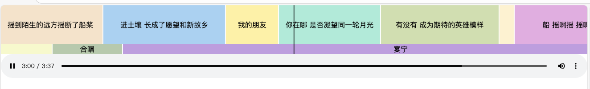
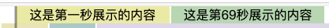
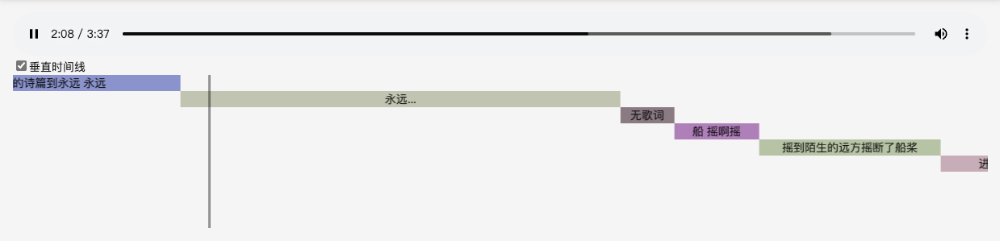

# react-timeline

一根时间线




# Breaking Changes

3.0.0 新增 `TraceWaterfall` 瀑布时间线；现有 `Timeline` / `Vertical` 的 API 与行为不变。

2.0以后，数据结构发生改变，需要重新更新代码

同时之后项目使用Vibe Coding，实现功能请参考`.trae/commands/code.md`

主要在时间轴数据结构上，以前的结构导致最后一个时间点的内容展示异常，所以现在加入了起始、结束时间点，时间是绝对的，也就是一个时间点内可以有多个轴共存。

## 安装

```bash
bun i react-av-timeline
# 或者npm i react-av-timeline
```

## demo
点击云原生开发后，运行`bun dev`

## 使用

首先引入组件，由于css未注入，需要手动引入css

````jsx
import Timeline from 'react-av-timeline';
import 'react-av-timeline/dist/index.css';
````

````jsx
<Timeline items={[{
        time:1,
        content:'这是第一秒展示的内容',
        style:{
            background: "#EAEAAD"
        }
    },{
        time:69,
        content:'这是第69秒展示的内容'
    }]} 
    currentTime={0}
    scale={0.5} 
    totalTime={91} />
````

效果如图



## 垂直时间线
适合类似导播台自动化等序列化的场景，将时间线垂直展示



````jsx
// 注意，引入方式不一样，非default导出
import { Vertical } from 'react-av-timeline';
import 'react-av-timeline/dist/index.css'
````

基本参数与普通时间线一致，请参考[API](#API)

````jsx
<Vertical height={190} left={20} items={[{
        time:1,
        content:'这是第一秒展示的内容',
        style:{
            background: "#EAEAAD"
        }
    },{
        time:69,
        content:'这是第69秒展示的内容'
    }]} currentTime={currentTime} scale={10} totalTime={100} />
````

## 瀑布时间线（TraceWaterfall）

用于音视频导播 / 剪辑：多轨、多片段、时间码、固定播放头、首行跟随。片段只有 `start` + `duration`，相同 `index` 即同一轨。

````jsx
import { TraceWaterfall } from 'react-av-timeline';
import 'react-av-timeline/dist/index.css';

const clips = [
    { id: 'lyric-0', name: '船 摇啊摇', index: 0, start: 10.473, duration: 1.766 },
    { id: 'lyric-1', name: '摇到陌生的远方摇断了船桨', index: 0, start: 12.239, duration: 3.848 }
]

<TraceWaterfall
    clips={clips}
    tracks={[{ index: 0, name: '歌词 1' }]}
    currentTime={currentTime}
    onCurrentTimeChange={setCurrentTime}
    formatTime={{ type: 'clock', millisecond: true }}
    fixedPlayhead
    playheadPosition={0.5}
    height={420}
/>
````

要点：

- `viewStart` / `viewDuration` 定义可 seek 的视图范围；晚于 `viewEnd` 的片段仍会渲染，但会压暗，`currentTime` 不会越过 `viewEnd`。
- `fixedPlayhead` 会在视图前后补留白，游标从起点到终点都停在 `playheadPosition`。
- `followMode` 非 `off` 时强制 `sequence` 平铺；支持 `scroll` 上滚与 `hide` 直接消失，`keepRowsAbove` 控制目标行上方保留多少行。
- `playing` 为 `true` 且开启了 `fixedPlayhead` 或 `followMode` 时，纵向滚动锁定（隐藏纵向滚动条），暂停后恢复自由滚动；不传默认不播放。
- `layout` 默认 `lanes`；`zoom` 受控、`defaultZoom` 非受控。
- 左侧标签列默认 `220px`，`labelWidth` 可定义初始宽度；`resizableLabel`（默认 `true`）开启拖拽把手，范围由 `minLabelWidth` / `maxLabelWidth` 限制，拖动时回调 `onLabelWidthChange`。
- 标签高度即行高：由 `rowHeight` 定义默认值，`TimelineTrack.height` 可按轨覆盖；`TimelineClip.height` 只控制条形高度（不超过行高减留白），不会改变标签行高。行与行之间的纵向间距用 `rowGap` 设置，默认 `0`。
- 条形高度跟随行高自适应，只保留上下留白；留白由 `--wf-bar-inset` 控制（默认 `7px`）。需要单独控制某个条形时用 `TimelineClip.height`，会被行高上限截断。
- `formatTime={{ type: 'number' }}` 使用固定 3 位小数（如 `1.500`），当前时间与总时间一致。
- 文案通过 `labels` 覆盖；颜色通过 CSS 变量 `--wf-*` 覆盖。

# 应用

可以结合audio或video，通过监听timeupdate事件，实时更新currentTime，实现同步播放

如[example/App.tsx](example/App.tsx)或者[https://cnb.cool/arsrna/visualize-music](https://cnb.cool/arsrna/visualize-music)

# API

## 通用

### 基本参数
````typescript
interface PropsType {
    /**时间轴数据 */
    items: itemsType[],
    /**每个时间块的统一样式 */
    itemStyle?: CSSProperties,
    /**当前播放/指示的时间点 */
    currentTime: number,
    /**总时长（决定了时间轴的总长度基准） */
    totalTime: number,
    /**缩放比例（默认 1） */
    scale?: number,
    /**时间轴指示器（中线）的 HTML 属性 */
    indicator?: HTMLAttributes<HTMLDivElement>
}
````

### itemsType
````typescript
interface itemsType {
    /** 
     * 时间点定义：
     * - [start, end]: 明确的起止时间范围
     * - number: 仅起始时间，结束时间默认为下一个 item 的起始时间或 totalTime
     */
    time: [number, number] | number,
    /** 该时间块对应的自定义样式 */
    style?: CSSProperties,
    /** 该时间块对应的内容（ReactNode） */
    content?: ReactNode,
    /** 
     * 显示层级（仅水平时间轴有效）：
     * 指定该元素显示在第几行。如果不指定，系统将自动计算不重叠的最小层级。
     */
    level?: number
}
````

## 垂直时间线 (Vertical)
垂直时间线除了通用参数外，还支持以下扩展参数：
````typescript
{
    /** 距离左侧指示器的保留项目数：当时间轴过去后，保留前几个项目不消失 */
    prev?: number,
    /** 指示器（中线）距离左侧的百分比位置（默认 10） */
    left?: number,
    /** 时间轴容器的总高度 */
    height?: CSSProperties['height']
}
````

## 瀑布时间线 (TraceWaterfall)

````typescript
interface TimelineClip {
    id: string
    name?: string
    index: number
    start: number
    duration: number
    label?: ReactNode
    color?: string
    style?: CSSProperties
    height?: number
    meta?: Record<string, unknown>
}

interface TraceWaterfallProps {
    clips: TimelineClip[]
    tracks?: { index: number, name?: string, height?: number }[]
    layout?: 'lanes' | 'sequence'
    unit?: 'ms' | 's'
    viewStart?: number
    viewDuration?: number
    currentTime?: number
    onCurrentTimeChange?: (time: number) => void
    formatTime?: TimeFormat | ((value: number) => string)
    formatDuration?: (value: number) => string
    fixedPlayhead?: boolean
    playheadPosition?: number
    playing?: boolean
    followMode?: 'off' | 'scroll' | 'hide'
    keepRowsAbove?: number
    zoom?: number
    defaultZoom?: number
    onZoomChange?: (zoom: number) => void
    labelWidth?: number
    resizableLabel?: boolean
    minLabelWidth?: number
    maxLabelWidth?: number
    onLabelWidthChange?: (width: number) => void
    rowHeight?: number
    rowGap?: number
    height?: CSSProperties['height']
    minTickGap?: number
    showTime?: boolean
    showDetail?: boolean
    showSearch?: boolean
    showZoom?: boolean
    emptyText?: string
    labels?: Partial<TimelineLabels>
    onClipClick?: (clip: TimelineClip) => void
    className?: string
    style?: CSSProperties
}
````

````typescript
type TimeFormat =
    | { type: 'number' }
    | { type: 'clock', millisecond?: boolean, offset?: number }
    | { type: 'smpte', fps: number, offset?: number }
````

- `formatTime` 用于绝对时间（应用 `offset`），`formatDuration` 用于时长（不应用 `offset`）。
- `currentTime` 受控；点击标尺触发 `onCurrentTimeChange`，点击片段只打开详情。
- `showSearch` / `showZoom` 可关闭内置搜索框与缩放按钮；关闭后可用受控 `zoom` 在外部控制缩放。
- `labels` 可覆盖 `search` / `noMatch` / `empty` / `current` / `total` / `track` / `start` / `end` / `duration` / `close` / `zoom` / `resize` / `lanesColumn` / `sequenceColumn`。
- 纯函数 `getActiveAt`、`getTopActiveAt`、`getClipEnd`、`resolveRange`、`buildRows`、`buildTicks`、`formatTime`、`formatDuration` 也可从包中导入。

## 重叠规则 (Level)
- **水平模式**：当多个 items 时间重叠时，系统会自动将它们纵向排列。你可以通过 `level` 属性手动强制指定某个 item 所在的行数（Level 0 为最上方）。
- **垂直模式**：垂直时间轴**不受 `level` 影响**。它始终保持每行一个 item，并根据时间进度实现自动消失和后续元素的向上补位。